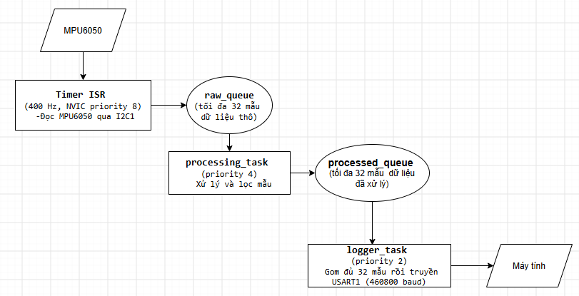

# Report — Week 4 / Ex1 (Design doc)

`student_id`: 2511006    Commit của PREDICTION.md: ______

> File này ĐÓNG VAI TRÒ design doc 2–3 trang nộp cho mentor duyệt trước khi
> viết code. Điền đủ số liệu — không mô tả chung chung.

## 1. Task diagram
Mô tả (sơ đồ ASCII hoặc ảnh chèn vào) luồng: ISR lấy mẫu MPU6050 → hàng đợi
→ task xử lý → task ghi UART. Ghi rõ priority từng task.

## 2. Timing budget
| Đại lượng | Công thức / nguồn số liệu | Giá trị |
|---|---|---|
| Chu kỳ lấy mẫu | 1 / `SAMPLE_RATE_HZ` |2,5ms |
| Latency ISR→task (đo thật, week3/ex1) |Theo report w3 ex1 | 16us|
| Thời gian xử lý 1 mẫu (ước lượng) | |100us|
| Tổng so với `ISR_TO_PROC_DEADLINE_US` |116us | Đạt  |

## 3. RAM budget
| Thành phần | Kích thước | Ghi chú |
|---|---|---|
| Queue (độ dài × cỡ phần tử) |1024 |2 queue x 32 mẫu x 16byte |
| Stack task lấy mẫu |0 |DÙng ISR thay vì task |
| Stack task xử lý |1536 byte |384 words × 4 byte |
| Stack task ghi UART | 1536 byte| 384 words × 4 byte|
| **Tổng** |4096 | nhỏ hơn so với `MAX_HEAP_BYTES`=10240 |

## 4. Lựa chọn API đồng bộ
Queue / event group / stream buffer — vì sao chọn cái này cho pipeline này.

Chọn Queue vì cần truyền cả mẫu cảm biến 16 byte và giữ đúng thứ tự mẫu. Event group chỉ truyền cờ sự kiện; stream buffer truyền luồng byte, phải tự chia ranh giới từng mẫu.

## 5. Xử lý khi hàng đợi đầy
Drop mẫu mới hay mẫu cũ? Có đếm số mẫu bị rớt để báo cáo ở ex3 không?

Khi queue đầy, bỏ mẫu mới, giữ mẫu cũ. ISR không được chờ queue có chỗ trống. Nếu gửi thất bại, cò đếm mẫu bị rớt bằng cách tăng  biến đếm dropped_raw_samples. Tương tự, task xử lý không chờ khi queue thứ hai đầy và tăng biến đếm dropped_processed_samples.

## 6. Mentor duyệt
Chữ ký / ghi chú của mentor sau buổi duyệt thiết kế: ______
